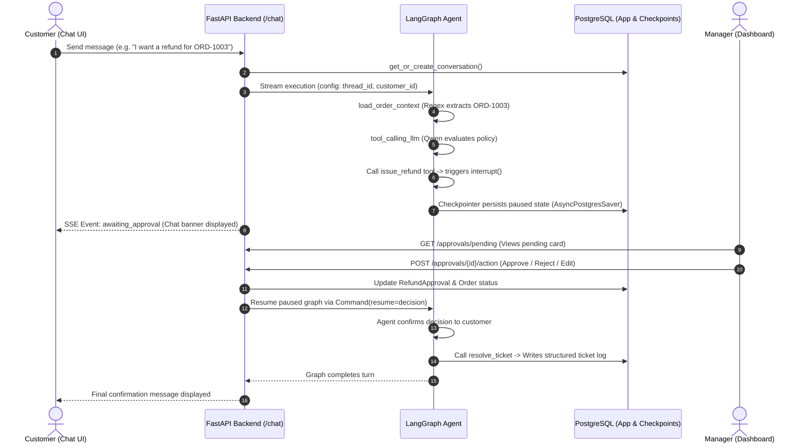

# Support Ticket Agent — System Architecture & Technical Specification

A production-grade customer support and refund agent built with **FastAPI**, **LangGraph**, **PostgreSQL**, and **React 19**. The system demonstrates autonomous tool calling, deterministic context injection, memory summarization, and human-in-the-loop (HITL) approval workflows for sensitive refund actions.

---

## 1. System Overview & Core Capabilities

- **Autonomous Customer Support**: Answers customer inquiries, checks order statuses, and assesses refund eligibility against company policy.
- **Human-In-The-Loop (HITL) Governance**: When a refund is proposed, the agent pauses via LangGraph's native `interrupt()`. Execution is frozen in PostgreSQL until a manager approves, rejects, or adjusts the refund amount.
- **Deterministic Context Injection**: Pre-fetches customer order records using regex matching (`ORD-\d+`) prior to model execution, eliminating unnecessary LLM tool-calling overhead.
- **Conversation Memory & Summarization**: Automatically condenses long chat histories when message length exceeds thresholds, preserving conversation context without exceeding model context limits.
- **Structured Audit Logging**: Direct persistence of resolution metrics (category, sentiment, resolution type, refund amount) into a relational audit table.

---

## 2. End-to-End System Workflow



---

## 3. Backend Endpoints (FastAPI)

All endpoints are built with FastAPI, use async database sessions, and enforce centralized Pydantic schemas defined in `backend/app/schemas.py`.

| Method | Path | Request Body | Response / Output | Purpose |
| :--- | :--- | :--- | :--- | :--- |
| `POST` | `/chat` | `ChatRequest` (`message`, `conversation_id`, `customer_id`) | `text/event-stream` (SSE) | Streams LLM tokens (`token`), tool execution notices (`tool_start`), HITL pauses (`awaiting_approval`), and completions (`end`). |
| `GET` | `/chat/{conversation_id}` | *None* | `list[dict]` (`type`, `content`) | Retrieves stored conversation message history from the LangGraph checkpointer for state restoration on refresh. |
| `GET` | `/approvals/pending` | *None* | `list[PendingApprovalResponse]` | Lists all active refund requests currently paused at HITL interrupts for manager review. |
| `POST` | `/approvals/{id}/action` | `ApprovalAction` (`action`, `final_amount`, `notes`) | `{"status": "resumed"}` | Resumes the paused LangGraph execution via `Command(resume=...)` with the manager's decision. |
| `GET` | `/tickets` | *None* | `list[TicketResponse]` | Returns all resolved tickets for executive auditing, filtering, and satisfaction analytics. |

---

## 4. Database Architecture & Models

The relational schema is managed via **SQLAlchemy (Async Engine)** and **Alembic** migrations.

### Relational Tables (`backend/app/db/models.py`)

1. **`customers`**
   - `id` (UUID, PK), `name` (String), `email` (String, Unique), `created_at` (DateTime UTC).
2. **`orders`**
   - `id` (String PK, e.g. `ORD-1001`), `customer_id` (UUID, FK), `item_name` (String), `amount` (Numeric 10,2), `status` (OrderStatus enum), `created_at` (DateTime UTC).
3. **`conversations`**
   - `id` (String PK, matches LangGraph `thread_id`), `customer_id` (UUID, FK), `status` (ConversationStatus enum: `OPEN`, `AWAITING_APPROVAL`, `RESOLVED`), `summary` (String, nullable), `created_at`, `updated_at`.
4. **`refund_approvals`**
   - `id` (UUID, PK), `conversation_id` (String, FK), `order_id` (String, FK), `proposed_amount` (Numeric 10,2), `final_amount` (Numeric 10,2, nullable), `reason` (String), `status` (RefundStatus enum: `PENDING`, `APPROVED`, `REJECTED`), `category` (TicketCategory, nullable), `sentiment` (SentimentType, nullable), `decided_at` (DateTime UTC, nullable).
5. **`tickets`** *(Structured Resolution Sink)*
   - `id` (UUID, PK), `conversation_id` (String, FK, Unique), `category` (TicketCategory enum), `sentiment` (SentimentType enum), `resolution` (ResolutionType enum), `refund_amount` (Numeric 10,2, nullable), `resolved_at` (DateTime UTC).

### Canonical Enums

```python
class OrderStatus(StrEnum):
    PENDING = "PENDING"
    PROCESSING = "PROCESSING"
    SHIPPED = "SHIPPED"
    DELIVERED = "DELIVERED"
    CANCELLED = "CANCELLED"

class ConversationStatus(StrEnum):
    OPEN = "OPEN"
    AWAITING_APPROVAL = "AWAITING_APPROVAL"
    RESOLVED = "RESOLVED"

class RefundStatus(StrEnum):
    PENDING = "PENDING"
    APPROVED = "APPROVED"
    REJECTED = "REJECTED"

class TicketCategory(StrEnum):
    BILLING = "BILLING"
    REFUND = "REFUND"
    ORDER_CANCELLATION = "ORDER_CANCELLATION"
    ORDER_INQUIRY = "ORDER_INQUIRY"
    TECHNICAL_SUPPORT = "TECHNICAL_SUPPORT"
    GENERAL = "GENERAL"

class SentimentType(StrEnum):
    POSITIVE = "POSITIVE"
    NEUTRAL = "NEUTRAL"
    NEGATIVE = "NEGATIVE"
    FRUSTRATED = "FRUSTRATED"

class ResolutionType(StrEnum):
    REFUND_ISSUED = "REFUND_ISSUED"
    REFUND_REJECTED = "REFUND_REJECTED"
    ORDER_CANCELLED = "ORDER_CANCELLED"
    INQUIRY_ANSWERED = "INQUIRY_ANSWERED"
    ESCALATED = "ESCALATED"
```

### LangGraph Checkpoint Persistence
LangGraph automatically manages state serialization across restarts through `AsyncPostgresSaver` in `main.py`:
- `checkpoints`, `checkpoint_blobs`, `checkpoint_writes`, `checkpoint_migrations`.

---

## 5. LangGraph Agent Graph Design

### State Definition (`backend/app/agent/state.py`)
```python
class SupportState(MessagesState):
    customer_id: str
    order_context: list[dict] | None       # Deterministically injected orders
    missing_order_ids: list[str] | None   # Any IDs customer typed that don't exist in DB
```

### LLM Strategy
- **Primary Engine**: Groq `qwen/qwen3.8-27b` (temperature: 0.0) — provides ultra-fast reasoning, strict tool-calling, and structured parameter generation.
- **Multi-Model Extensibility**: Initialized placeholder for Google Gemini (`gemini-2.5-flash`) reserved for complex analytical or multi-modal tasks.

### Graph Nodes & Topology (`backend/app/agent/graph.py`)

1. **`load_order_context`**: Deterministic node running on `START`. Scans human messages with `re.compile(r"\bORD-\d+\b")` and queries the database directly to populate `state["order_context"]`.
2. **`summarize`**: Condenses message history using Groq Qwen when `len(messages) > 6`, replacing older turns with a `SystemMessage` summary while retaining recent turns.
3. **`tool_calling_llm`**: Binds the core tool definitions and drives conversation or calls tools.
4. **`tools`**: LangGraph `ToolNode` executing available tools:
   - `check_refund_eligibility(order_id)`: Checks order date, status, and maximum refundable amount.
   - `issue_refund(order_id, amount, reason)`: Validates request, records pending approval in DB, and invokes native `interrupt()`. Upon resumption, reads the manager's injected payload.
   - `resolve_ticket(category, sentiment, resolution, refund_amount)`: Writes final structured ticket record directly to the database and marks conversation as resolved.

### Edge Routing

```
START ──> load_order_context ──[ should_summarize ]──┬──> summarize ──> tool_calling_llm
                                                     └──> tool_calling_llm
tool_calling_llm ──[ tools_condition ]──┬──> tools ──> tool_calling_llm
                                        └──> END
```

---

## 6. Frontend Architecture (React 19 + Tailwind v4)

Built with a modular layout, reactive custom hooks, and Tailwind CSS v4.

```
frontend/src/
├── assets/api/
│   ├── client.js              # REST client wrapper for approvals, tickets, and history
│   └── stream.js              # SSE streaming reader with chunk decoder
├── components/
│   ├── ApprovalBanner.jsx     # Amber status banner in chat when conversation is paused
│   ├── ApprovalCard.jsx       # Card displaying order info, badges, and action buttons
│   ├── Badge.jsx              # Status, sentiment, and resolution indicator badges
│   ├── EmptyState.jsx         # Clean empty state view with icons
│   ├── MessageBubble.jsx      # Markdown-ready chat bubble with copy button & streaming cursor
│   ├── Modal.jsx              # Accessible modal for Edit, Reject, and Detail views
│   ├── StatCard.jsx           # Dashboard metric cards for totals and satisfaction
│   └── StatusIndecator.jsx    # Real-time tool execution pill ("Looking up order records...")
├── hooks/
│   ├── useApprovals.js        # Approvals data fetching, modal states, and action execution
│   └── useTickets.js          # Tickets query, client filtering, search, and KPI calculations
├── layouts/
│   └── AdminLayout.jsx        # Navigation header and active tab indicators (/admin/*)
├── screens/
│   ├── Chat.jsx               # Screen A: Customer streaming chat interface
│   ├── Approvals.jsx          # Screen B: Manager refund approvals dashboard
│   └── Tickets.jsx            # Screen C: Resolved tickets audit table & KPI analytics
└── App.jsx                    # React Router configuration
```

### Screens Summary

* **Screen A — Chat (`/`)**:
  - Live token streaming via SSE.
  - Active tool indicators during backend operations.
  - Interactive approval alert banner with direct navigation to the admin approval view.
  - LocalStorage-backed conversation session persistence.
* **Screen B — Pending Approvals (`/admin/approvals`)**:
  - Live list of pending refund interrupts.
  - One-click **Quick Approve**.
  - **Edit Amount Modal**: Manager adjusts refund amount with required notes before approval.
  - **Reject Modal**: Manager declines refund with mandatory rejection reason.
* **Screen C — Tickets Audit Log (`/admin/tickets`)**:
  - Structured audit log showing sentiment, resolution, and refund amounts.
  - Live search across customers and resolution details.
  - Category, Sentiment, and Resolution filtering.
  - Executive summary metrics (Total tickets, Total refunded, Satisfaction percentage).

---

## 7. Portfolio & Architectural Highlights

1. **Zero LLM Token Waste on Context**: Uses deterministic regex matching for order context loading instead of forcing the LLM to spend extra turns calling lookup tools.
2. **True State Machine Pausing**: Employs LangGraph's native `interrupt()` and PostgreSQL checkpointing rather than custom polling queues. The server can restart while a refund is pending without losing state.
3. **No Redundant Extraction Passes**: Rather than running a secondary LLM extraction pass for ticket auditing, the agent leverages typed tool signatures (`resolve_ticket`) to validate and persist structured records directly.
